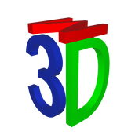
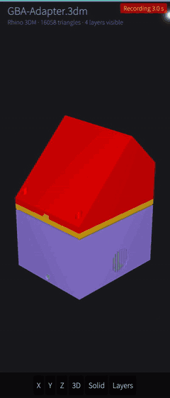
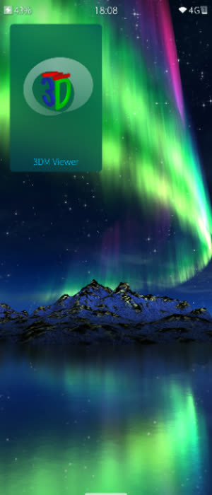

<p align="center">
  
</p>

<h1 align="center">3DM Viewer — a read-only CAD and G-code viewer for Sailfish OS</h1>

3DM Viewer opens a CAD file on the phone, draws it, and lets you turn it around.
It is a **viewer and nothing else**: there is no editing and no save path
anywhere in the program, so it can never write over the file you opened.
Everything runs on the device — no network, no telemetry, no cloud component.

> Developed and tested on a **Sony Xperia 10 III** (`pdx213`) running Sailfish OS
> 5.1.0.11. Much of it should work on other Sailfish OS devices too, but that is
> the only one it has actually been verified on.

<p align="center">
  
  &nbsp;&nbsp;
  
</p>

## What it does

- **Five formats**, all drawn by the same renderer:

  | Format | What it reads |
  |--------|---------------|
  | `.3dm` | Rhino models, from the render meshes Rhino stores in the file |
  | `.stp` `.step` | STEP solids — planes and cylinders, tessellated on the phone |
  | `.stl` | Binary and ASCII |
  | `.3mf` | Objects, instances and colours, as slicers save them |
  | `.bgcode` | PrusaSlicer binary G-code, drawn as the toolpath it is |

- **Turn it around** — orbit with one finger, pinch to zoom, double tap to fit.
- **Locked views** — X / Y / Z square-on, each further tap a quarter turn, plus
  a free 3D view.
- **Three display modes** — solid, wireframe and see-through.
- **A switch per layer** — Rhino layers, STEP solids, 3MF objects, or the
  extrusion types of a sliced file, starting from the visibility stored in the
  file.
- **A print-layer slider** for sliced files: peel layers away from the top and
  the bottom, the way the slicer's own preview does.
- **Model info** — counts, bounding size, and the application that wrote the
  file.
- **A drop simulation** — turn the model into a falling rigid body that tumbles
  onto its real corners, with the phone's accelerometer steering gravity.

No sample models are shipped. Bring your own — that is what the file picker is
for.

## How STEP is drawn

Every other format hands over triangles, or a mesh the CAD system already
computed. STEP hands over **mathematics**: a face is a surface plus the loops of
curves that cut a piece out of it, and nothing in the file says where a triangle
goes. So the app builds them itself, on the phone:

1. sample each boundary curve into points,
2. map those into the surface's own `(u,v)` coordinates with an exact inverse —
   where a cylinder is simply a flat rectangle,
3. triangulate that flat polygon-with-holes by ear clipping,
4. map the corners back to 3D and take exact normals there.

Only step 3 is generic, which is the point: one triangulator serves every
surface type, and adding a cone or a sphere later means writing an evaluation
and an inverse, not another mesher.

## What it will not do

- **Rhino** — surfaces come from the render meshes inside the file. A model
  saved with *Save Small* has none and cannot be shown. Block instances, curves,
  annotation and lights are not drawn.
- **STEP** — faces on a plane or a cylinder are tessellated. Any other surface
  type is counted and reported, not drawn. That covers the great majority of
  mechanical parts, whose faces are flat or round, but it is not the whole
  standard.
- **3MF** — beam lattices, slice stacks and textures are skipped, and ZIP64
  archives are not read.

Whatever cannot be shown is **said out loud**, never left silently missing.

## Install

Download the RPM from the releases page and, on the phone:

```sh
pkcon install-local -y harbour-3dmviewer-0.1.0-1.aarch64.rpm
```

## Building

Requires the [Sailfish OS SDK](https://sailfishos.org/develop/). openNURBS is a
submodule, so fetch it first:

```sh
git submodule update --init
mb2 --target SailfishOS-5.0.0.62-aarch64 build
```

That first build compiles openNURBS — roughly 250 source files — and takes a
while. It is a static library, so later builds do not repeat it.

## Status & responsible use

**Proof of concept**, shared **as is** with **no warranty** of any kind (see the
GPLv3). The STEP tessellator in particular is new code judged against a small
number of real files; if a face comes out missing or inside out, that is where
to look. It is a viewer, not a measuring instrument — do not take a dimension
off it and cut metal to that.

## Licence and credits

Licensed under the **GNU General Public License v3.0 or later** — see
[`LICENSE`](LICENSE).

`.3dm` is read with the [openNURBS toolkit](https://github.com/mcneel/opennurbs)
by Robert McNeel & Associates, included as a **pinned submodule** rather than a
copy and compiled in statically, together with the zlib and uuid code it
bundles. Why it is a submodule, and what its licence position actually is, is
set out in [`lib/OPENNURBS.md`](lib/OPENNURBS.md).

The **STEP, STL, 3MF and binary G-code readers are written for this
application** and use nothing beyond Qt. The `.bgcode` reader in particular is
written from the published format description rather than derived from Prusa's
own `libbgcode`, which is AGPL and would otherwise have set the licence of this
whole program.

Not affiliated with or endorsed by Robert McNeel & Associates. "Rhinoceros",
"Rhino3D" and "openNURBS" are their trademarks; this application's icon is an
original drawing and is not their mark. Not affiliated with or endorsed by Prusa
Research.
